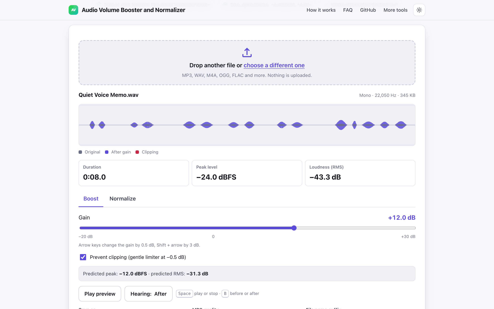
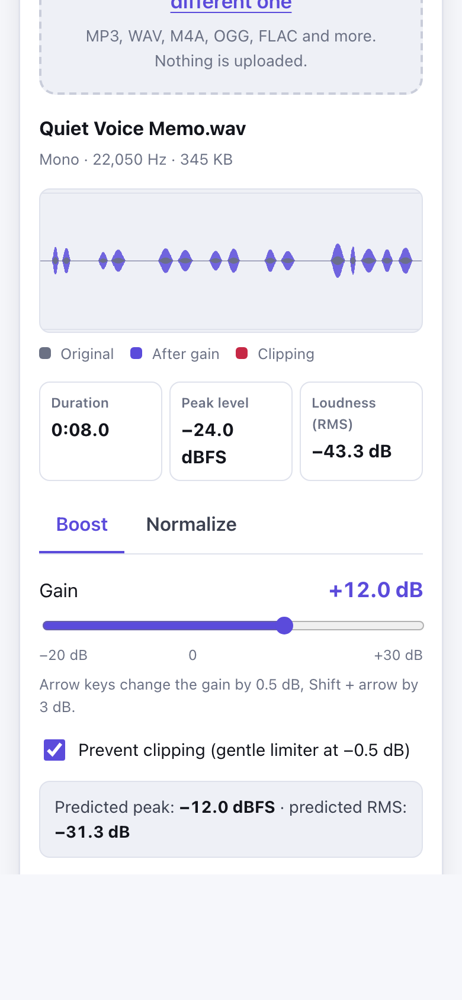

# Audio Volume Booster and Normalizer

> Make quiet audio louder or normalize it to a target level in your browser, with no upload.

**🌐 Use it now: [turhe123.github.io/audio-volume-booster](https://turhe123.github.io/audio-volume-booster/)** · free · open source · runs in your browser · works offline


## Why

This is a free, open-source alternative to online MP3 volume booster and louder tools such as Clideo Change Volume and 123apps Volume Changer (upload your audio, ads, watermarks or account walls on longer files). Here your files never leave the device, there is no account, no ads and no limits, it works offline, and it can be installed as an app.

## Screenshots

<p align="center"></p>

<p align="center"><em>Audio Volume Booster and Normalizer in the browser, light theme</em></p>

<p align="center"></p>

<p align="center"><em>Audio Volume Booster and Normalizer on a phone</em></p>

## Features

- Analyses the file and shows duration, peak level (dBFS) and average loudness (RMS, dB). A silent file is reported as "Silent" and the controls are disabled.
- Waveform overview that shows the original, the waveform after gain, and where clipping would occur.
- **Boost** mode: gain slider from −20 to +30 dB (default +6 dB) with a predicted peak and RMS, and a clipping warning that estimates the share of samples that would be cut off.
- **Normalize** mode: pick a peak target (default −1 dBFS) or an RMS target (default −16 dB); the gain is computed for you.
- Optional **Prevent clipping**: a gentle tanh-style limiter with a ceiling of −0.5 dBFS. Without it, samples are hard-clamped at 0 dBFS.
- Before and after preview with a toggle, looping playback and a moving playhead.
- Keyboard: Space plays or stops, B switches before and after, arrow keys change the gain by 0.5 dB (Shift: 3 dB).
- Export as **MP3** (128, 160, 192 default, 256 or 320 kbps) or **WAV** (16-bit). The output name is the original name plus a suffix you choose (default `louder`); Unicode names are kept.
- After saving, the result card shows the measured peak and RMS of the real output, plus its file size, and a Download button.
- Warnings for sources that are already clipped (this cannot be repaired) and for recordings longer than about an hour (high memory use).
- Mono and stereo are handled, and the original sample rate is preserved. Encoding runs in a Web Worker.
- Includes a built-in fictional sample, "Quiet Voice Memo".
- Errors for non-audio or unreadable files appear inline on the page.

**Formats and limits**

- Input: whatever your browser can decode, typically MP3, WAV, M4A/AAC, OGG/Opus, FLAC, WebM and AIFF.
- Output: MP3 or WAV. MP3 needs 1 or 2 channels and a standard sample rate (8 to 48 kHz); otherwise the tool saves WAV. At lower sample rates the MP3 format caps the bitrate, and the tool tells you when it does.
- One file at a time. There is no fixed size limit, but very long files need a lot of memory, especially on phones.

## How to use

1. Drop an audio file on the page, or choose one (or try the sample recording).
2. Check the peak and loudness readout, then pick **Boost** and set the gain, or pick **Normalize** and set a peak or RMS target.
3. Press Play preview and switch between before and after. Turn on Prevent clipping if the clipping warning appears.
4. Choose MP3 or WAV and a file name suffix, then press Save.
5. Check the measured peak and RMS of the result, then press Download.

## Privacy

- Nothing is uploaded. Files are decoded, processed and encoded on your device.
- No cookies.
- Page views are counted anonymously with [GoatCounter](https://www.goatcounter.com/) (cookieless, open source).
- Offline use comes from a service worker that caches the page after the first visit.

## Run it locally

```sh
git clone https://github.com/turhe123/audio-volume-booster
cd audio-volume-booster
python3 -m http.server 4173
```

Then open http://127.0.0.1:4173/. There is no build step.

## Tests

```sh
npm i -D @playwright/test && npx playwright install chromium
npx playwright test
```

## Third-party code

- [lamejs](https://github.com/zhuker/lamejs) 1.2.1, LGPL-3.0, used for MP3 encoding (`vendor/lamejs/`).

## Built with AI

Audio Volume Booster and Normalizer was written by [Claude Code](https://claude.com/claude-code) inside an automated pipeline, from a plain-English spec. No code or assets from any commercial product were used; it is a clean-room implementation of a feature set, not a copy.

What that means in practice:

- The full source is in this repo under the MIT license. Read it before you trust it with your files.
- Everything runs in your browser. It makes no network requests except an anonymous, cookieless page-view count (GoatCounter); your files never leave the device.
- The page is tested headless in Chromium (Playwright) before every release, but it has had less human review than hand-written software. Bug reports and pull requests are welcome.

## Support ❤️

If this saved you time or a subscription, you can support the project on [Ko-fi](https://ko-fi.com/leodavidai).

## More free web tools

Find more at [turhe123.github.io/web-tools](https://turhe123.github.io/web-tools/).

Also: [free, open-source Mac apps](https://turhe123.github.io/mac-apps/) built the same way, native Swift, no accounts, no telemetry.

## License

MIT © Or Davidai Bachar
